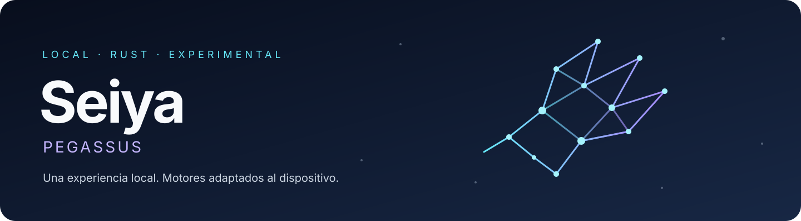
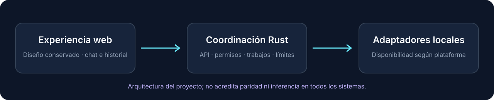

# Seiya · Pegassus

**A local-first AI application with a shared web interface and native model adapters.**

[Español](readmees.md) · [Downloads](#downloads) · [Project status](docs/ESTADO_FUNCIONAL.md) · [Report feedback](https://github.com/spirock/seiya/issues)

Seiya brings model setup, local chat, background drafts and image jobs into one
web interface. Its shared coordination logic is written in Rust; the frontend
stays HTML/CSS/JavaScript. **Pegassus** is the public model identity
(`seiya/pegassus`), not an extra set of model weights.

> **Experimental software.** Installers contain the application, not model
> weights or inference engines. A successful build is not evidence of working
> inference on every device. Packages are currently unsigned; macOS packages
> are not notarized. See the platform limits before installing.

## Downloads

<!-- seiya-downloads:start -->
**Latest verified build:** [`665edce`](https://github.com/spirock/seiya/actions/runs/43590893876).

| Platform | Download |
|---|---|
| Windows x64 | [.exe installer](https://github.com/spirock/seiya/actions/runs/43590893876/artifacts/14112217828) · [Portable ZIP](https://github.com/spirock/seiya/actions/runs/43590893876/artifacts/14112148576) |
| macOS Apple Silicon | [DMG · drag to Applications](https://github.com/spirock/seiya/actions/runs/43590893876/artifacts/14112481523) · [Optional PKG](https://github.com/spirock/seiya/actions/runs/43590893876/artifacts/14112765862) |
| Linux x64 | [.deb](https://github.com/spirock/seiya/actions/runs/43590893876/artifacts/14111124687) |
<!-- seiya-downloads:end -->

GitHub Actions updates both language versions after the complete build succeeds.
Artifacts are delivered inside ZIP archives, may require a GitHub login, and
expire under GitHub's retention policy. Check the build commit in
`BUILD-INFO.json`: the filename alone, currently version 0.1.0, is not enough.

On macOS, open the new DMG and drag **Seiya Rust.app** to **Applications**,
then open it from Applications. The separate optional PKG also installs terminal
wrappers. Older builds contain a PKG inside the DMG; check the build commit.
Opening the app should show setup without starting inference. Configure an
already prepared, compatible engine and models, review the effects, then confirm.
No model download, accessibility permission or desktop control is enabled for you.

[Installation and feedback guide](docs/PRUEBA_INSTALADOR.md) ·
[Package requirements](docs/PAQUETES_PRUEBA.md) ·
[Windows](docs/WINDOWS_RUST.md)

## What Seiya does

- **Web-first setup:** detect known Ollama executable locations, edit paths and
  review configuration before starting the host. Finding an executable is not
  proof that its model formats are compatible.
- **Replaceable text models:** configure a brain and optional worker group using
  exact bindings exposed by prepared local OpenAI-compatible engines. Workers
  produce text drafts; they do not execute code or edit projects.
- **Image jobs:** opt-in structured requests from chat, a manual image control,
  observed job status, cancellation and validated PNG recovery. Native image
  decoding and the current native image pipeline are macOS-only.
- **Controlled native lifecycle:** the macOS Ollama/image adapters alternate
  owned processes. The next model cannot start until owned cleanup is confirmed.
  This does not certify a measured amount of free RAM or VRAM.
- **Opt-in web search:** bounded public search and reading with host-controlled
  source IDs and citations. Queries are sent to DuckDuckGo; this feature is not
  offline, and citation validation does not prove an answer is factually correct.
- **Recovery without automatic replay:** conversation history stays in the
  browser; configured job/PNG snapshots can survive a host restart without
  silently regenerating work.



## Platform status

This table describes the current sources. Download only the build identified
above: an older artifact may not contain a newer feature.
**🧪 Experimental / limited validation · — Not available in that native route.**

| Feature | macOS Apple Silicon | Linux x64 | Windows x64 |
|---|---|---|---|
| Installer / package pipeline | PKG and DMG | DEB | EXE and portable ZIP |
| Shared web setup and editable Ollama paths | 🧪 | 🧪 fixtures | 🧪 fixtures |
| Text catalog with prepared external HTTP engines | 🧪 | 🧪 contracts/mocks | 🧪 contracts/mocks |
| Opt-in web search | 🧪 fixtures | 🧪 fixtures | 🧪 fixtures |
| Native image generation and chat image requests | 🧪 fixtures / historical isolated image test | — | — |
| Native sequential model lifecycle | 🧪 owned-process fixtures | — | — |
| OpenCode integration through a partially compatible API | 🧪 earlier isolated trials | 🧪 contracts/mocks | 🧪 contracts/mocks |
| Installation, GUI and sustained inference validated on your device | Not yet | Not yet | Not yet |
| Signed / notarized packages | No | No | No Authenticode |

Serving the web interface does not provide native macOS inference on Windows or
Linux. Those platforms currently need separately prepared HTTP engines. The DEB
requires the glibc version declared by its build. macOS Intel and Linux/Windows
ARM64 do not currently have verified downloads.

[Detailed status](docs/ESTADO_FUNCIONAL.md) ·
[Platform differences](docs/PARIDAD_RUST.md) · [Roadmap](ROADMAP.md)

## Models and compatibility

The text/image catalogs let compatible external bindings be changed by role;
they do not make arbitrary weight formats executable. External engines manage
their own residency: the OpenAI API does not define a general load/unload protocol.

The separate native macOS profile retains its verified pins:

| Component | Native profile role |
|---|---|
| Gemma 4 E2B · `gemma4:e2b-mlx` | Main conversation / structured tool proposals |
| Qwen 3.5 9B · `qwen3.5:9b-mlx` | Optional sequential draft worker |
| Qwen-Image-2.1-Turbo · `Q4_K_M` | Image generation pipeline |
| Qwen3-VL-8B-Instruct · `UD-Q4_K_XL` | Image pipeline text encoder, not conversational vision |
| VAE Qwen-Image-2.1 · `BF16` | Image decoder component, not a chat model |

These are not bundled downloads or a promise that any standard Ollama install
supports the native profile. The native request budget remains 3584 bytes;
oversized context is rejected, not silently shortened. A configured model is
not necessarily loaded, and enabled models are not assumed to fit in memory together.

[Local engine setup](docs/BACKENDS_LOCALES.md) ·
[Image requests](docs/IMAGENES_DESDE_CHAT.md) ·
[Native lifecycle](docs/RESIDENCIA_NATIVA.md)

## Safety, privacy and current limits

- Loopback web access, authentication, validation and explicit review precede
  execution. The web session and OpenCode API credentials are separate.
- Model replies, pages and tool outputs are untrusted data, never permissions.
- No silent remote fallback, embedded credentials or automatic model downloads.
- An uncertain process or request leaves a durable journal/quarantine. Do not
  delete it to retry or fall back to an old binary without operational review.
- Vision, desktop control, mail access and a general tool/plugin loader are
  **not implemented**. A future tool directory must not execute files on discovery.
- Seiya does not execute OpenCode's tools a second time. The API integration is
  partial, not an installed OpenCode plugin or automatic client configuration.

Current regressions use synthetic runtimes, HTTP fixtures and owned helper
processes. Earlier short macOS model trials do not validate the new launcher,
every model, real VRAM release or sustained sessions. Installing and testing the
app on a real device is a separate validation step.

## Help improve Seiya

Try the appropriate installer, read the setup guide, and
[share a reproducible issue](https://github.com/spirock/seiya/issues).
Include the build commit, OS/architecture, the failing step and a redacted error.
**Do not post API keys, cookies, session URLs, conversations or personal paths.**
If the project is useful to you, starring or sharing the repository helps others
discover it. Contributions should include tests and honestly document limitations.

## Development and documentation

```sh
make test
cargo fmt --all -- --check
cargo clippy --workspace --all-targets --locked -- -D warnings
```

Normal tests do not download weights or start inference engines. The retained
Python prototype lives in `swarm-app/`; it is not replaced merely because Rust
compiles. Shared new logic lives in Rust, while HTML/CSS/JavaScript and the
existing interface design are preserved.

[Contributing](CONTRIBUTING.md) · [Product contract](docs/CONTRATO_SEIYA.md) ·
[Rust server](crates/seiya-server/README.md) ·
[OpenCode trial evidence](docs/PRUEBA_RUST_OPENCODE.md)

Most detailed technical documents are currently in Spanish; the
[Spanish README](readmees.md) retains the extended technical overview.

## License

The application is distributed under [Apache-2.0](LICENSE).
Dependencies and model weights have their own licenses; see
[third-party notices](THIRD_PARTY_NOTICES.md). A compiled executable is not a
place to hide secrets, and Rust alone does not guarantee faster inference.
